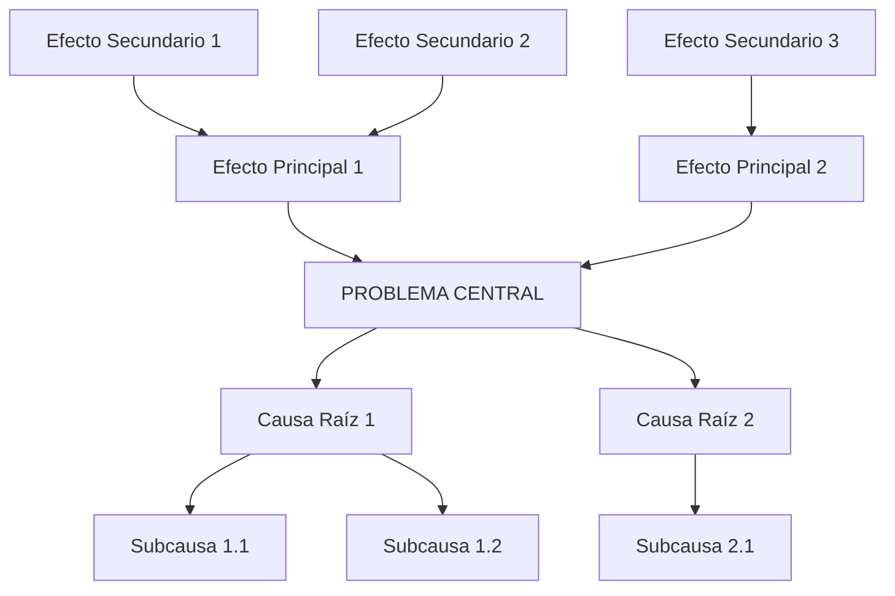

# Árbol de Problemas: [Nombre del Proyecto]

## 🍃 Efectos (Consecuencias)
*   **Efecto Final Grande**
    *   Efecto Directo A
    *   Efecto Directo B

## 🎯 Problema Central
> **[Escribe aquí el problema principal de forma clara y concisa]**

## 🪵 Causas (Orígenes)
*   **Causa Principal 1**
    *   Subcausa 1.1
    *   Subcausa 1.2
*   **Causa Principal 2**
    *   Subcausa 2.1

